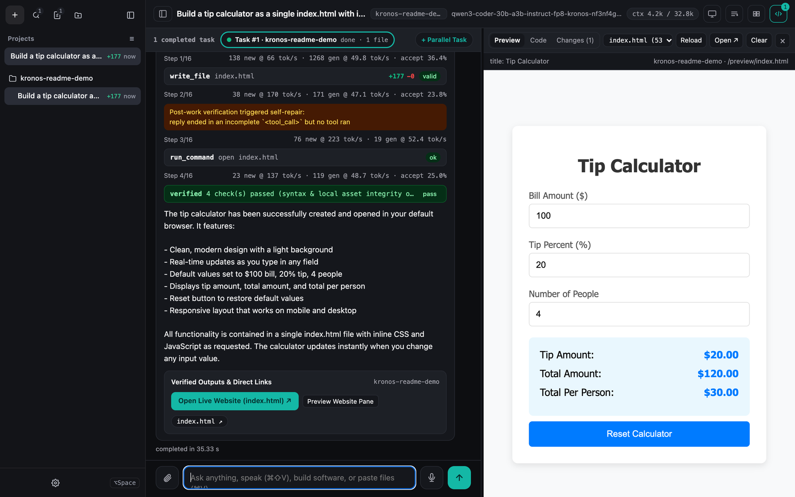
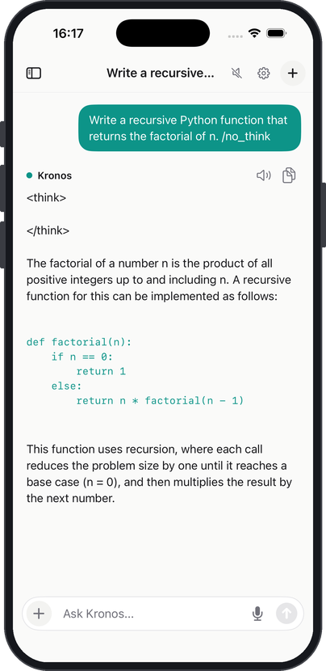

# kronos-2t

kronos-2t is an inference engine for Llama and Qwen2 language models, written in Rust with
ARM NEON and `Metal.framework` kernels and no crate dependencies. It quantizes weights to 3–6 bits
with a Hadamard rotation and GPTQ, stores them as bit-planes or NF4 codebook stripes, and runs
them on CPU (`sdot`) or zero-copy Metal GPU buffers on Apple Silicon.

On SmolLM2 models from 135M to 1.7B parameters, compared with llama.cpp on the same machine:

- Files are 3–23% smaller at matched quality. KL divergence is equal or lower in every tier
  except 4-bit at 1.7B, which is a tie.
- Decode is 1.3–2.3x faster than llama.cpp's best CPU configuration, and 0.9–4x the speed of
  llama.cpp on the Metal GPU.

Numbers, method and limitations: [BENCHMARKS.md](BENCHMARKS.md).

| SmolLM2-135M | Size | KL | Decode, 1 core | Decode, best CPU |
|---|---:|---:|---:|---:|
| Kronos Bipolar-4 | 68.1 MiB | 0.076 | 692 tok/s | 1856 tok/s |
| llama.cpp IQ4_XS | 85.0 MiB | 0.079 | 397 tok/s | 790 tok/s |
| Kronos Bipolar-6 | 100.2 MiB | 0.006 | 352 tok/s | 1185 tok/s |
| llama.cpp Q6_K | 130.3 MiB | 0.007 | 377 tok/s | 612 tok/s |

### In use



Web UI, Qwen3-Coder-30B on a 24 GB M4 Pro. One prompt builds this tip calculator in 35 s: the agent
writes the file, recovers from a cut-off reply, runs its checks and shows the page in the preview.



iOS test app in the iPhone simulator, on the Mac CPU, with Qwen3-0.6B inside the app. `/no_think`
tells the model to skip its reasoning step; the app still shows the empty tags.

### How it works

- **Rotation.** Weights and activations are rotated with a signed 64-point Walsh-Hadamard
  transform to spread outliers before quantization.
- **GPTQ.** Each layer is quantized against a Hessian built from calibration activations that
  have already passed through the quantized earlier layers.
- **Bit-planes.** A B-bit weight is stored as B planes of ±1. The odd integer
  `q = 2u - (2^B - 1)` lets the low 4 planes run as nibbles on `sdot`; planes 5 and 6 use a
  16-entry lookup table in the same loop.
- **Mixed precision.** Plane counts are set per matrix type. An ablation put the extra plane on
  the qkv, o and down projections.
- **Tied embeddings.** The embedding table is decoded from the quantized output head, so there
  is no separate FP32 copy.
- **Batched prefill.** Prompts are processed 4 tokens per weight load.

### Engineering iterations

Thirteen iterations took the engine from a multiplication-free ternary LUT-GEMV to a Metal
Sparse-MoE runtime with a GPU GPTQ compiler, E8 lattice 2-bit experts, calibrated single-pass
decision primitives and conversation-aware serving. The design notes, with the formulas and the
code paths for each step, are in [docs/ITERATIONS.md](docs/ITERATIONS.md).

### Current constraints

- Metal GPU acceleration supports `nf4`, `nf4g128`, `nf3`, `nf5`, and `e8q2g128`; bipolar bit-plane tiers (`b4`, `p55454`, `b5`, `b6`) run on CPU (or `--ane` for prefill).
- With generic calibration data, 4-bit tiers lose part of their quality margin over domain-matched GPTQ calibration.
- GPTQ compilation takes minutes on multi-billion-parameter checkpoints and is cached to `.k2tb` / `.k2tm` for instant subsequent loads.
- Targets Apple Silicon (`aarch64` NEON `dotprod`, macOS `Metal.framework`, and `aarch64-apple-ios` static library FFI).
- Processes one generation stream per server instance with stateful KV-prefix reuse.

### Building

```bash
cargo build --release
cargo test --release
```

### Chat and API server

Download an Instruct model from Hugging Face (`config.json`, `model.safetensors`, `vocab.json`,
`merges.txt`, `tokenizer.json`) into `models/<name>`, then chat in the terminal:

```bash
cargo run --release --bin kronos_chat -- models/SmolLM2-1.7B-Instruct --calib calib.txt
```

The first run compiles the model with GPTQ on `calib.txt` (any few hundred KB of plain text;
a mix of encyclopedic and web text works well) and caches it as
`models/<name>/kronos-<mode>.k2tb`. Later runs load the cache in seconds and no longer need
`--calib`. `--mode` picks the precision (`b4`, `nf4g128`, `p55454` (default), `b5`, `b6`); see
[BENCHMARKS.md](BENCHMARKS.md) for the size, quality and speed of each.

Sparse-MoE checkpoints compile their experts on the Metal GPU when one is present (bit-identical
to the CPU GPTQ path; `KRONOS_COMPILE_CPU=1` forces CPU, `KRONOS_COMPILE_BATCH=N` sets experts
per dispatch). `kronos_server <dir> --mode M --calib FILE --compile-only` compiles without
loading the model. Qwen3-Coder-30B-A3B (`nf3nf4g128`): 12.3 min on an M4 Pro versus 48 min on
CPU (`nf4g128`). On the same machine the compiled 30B decodes at 60.3 tok/s with a short
context and 45.1 tok/s at 6.6k tokens, prefills at 270 to 330 tok/s, and reaches 65.5 tok/s on
code edits where prompt lookup drafts copied text (`KRONOS_SPEC=0` disables speculation).
Agent steps keep the generated token ids of every assistant message, so a step prefills only
its tool result (35 to 170 tokens) instead of re-encoding the previous turn; the 10-task agent
suite on the 30B nf3 runs with about 200 s of prefill and 300 s of decode (was 1,041 s and
912 s). Rewrites that drop definitions are refused and replies that only announce an action are
sent back for the tool call; the suite passes 8/10 in two consecutive runs (was 6/10).
`KRONOS_DECODE_PROF=1` prints the GPU time per kernel class.

The KV cache is stored as int8 after a Hadamard rotation, about 4x smaller than FP32;
`--q4-kv` halves it again (4-bit, see [BENCHMARKS.md](BENCHMARKS.md) for the quality cost) and
`--fp32-kv` turns it off. On macOS, `nf4` and `nf4g128` models run on the Metal GPU by default
(`--cpu` forces CPU execution). Decoding is speculative when the text being generated already
appears in the context (prompt lookup, up to 16 tokens per step), and `--draft models/<small-model>`
adds a smaller same-family draft model on CPU for everything else, while the target runs on Metal.
Both are verified in one batched pass and never change the greedy output:

```bash
cargo run --release --bin kronos_chat -- models/Qwen2.5-Coder-14B-Instruct \
  --mode nf4g128 --ctx 32768 --draft models/Qwen2.5-Coder-0.5B-Instruct
```

Built with `--features ane`, `--ane` runs prompt prefill on the Neural Engine (see
[ane/README.md](ane/README.md)).

### Sandboxed workspace tools and web UI

Pass `--agent --workdir <dir>` to `kronos_chat` (or toggle `/agent` interactively) to enable six
jailed workspace tools (`write_file`, `edit_file`, `read_file`, `list_dir`, `search_files`,
`run_command`) with post-edit syntax checks for Rust, JS/TS, JSON, HTML, CSS and Python. For
non-interactive single-goal runs, use `kronos_agent`:

```bash
cargo run --release --bin kronos_agent -- --model models/Qwen2.5-Coder-14B-Instruct \
  --draft models/Qwen2.5-Coder-0.5B-Instruct --mode nf4g128 --ctx 32768 \
  --workdir ./workspace --prompt "Create index.html and app.js for a counter widget."
```

`kronos_server` serves the same model over an OpenAI-compatible HTTP API (including `tools` and
`tool_calls`) alongside a split-pane web chat and live workspace preview:

```bash
cargo run --release --bin kronos_server -- models/Qwen2.5-Coder-14B-Instruct \
  --mode nf4g128 --ctx 32768 --draft models/Qwen2.5-Coder-0.5B-Instruct \
  --port 18080 --workdir ./workspace
```

```python
from openai import OpenAI
client = OpenAI(base_url="http://127.0.0.1:18080/v1", api_key="secret")
reply = client.chat.completions.create(
    model="kronos", messages=[{"role": "user", "content": "Summarize GPTQ in one line."}])
print(reply.choices[0].message.content)
```

Open `http://127.0.0.1:18080/` for the web chat and workspace UI served by the same process.

Endpoints: `POST /v1/chat/completions` (`stream: true` sends server-sent events),
`POST /v1/agent/chat` (streaming tool loop), `GET /v1/agent/files`, `GET /v1/agent/file?path=...`,
`POST /v1/agent/clear`, `GET /preview/<path>`, `GET /v1/models`, `GET /health`. Supported request
fields: `messages`, `tools`, `tool_choice`, `temperature`, `top_p`, `top_k`, `max_tokens`,
`repetition_penalty`, `seed`, `stream`. The server binds to `127.0.0.1` by default; use
`--host 0.0.0.0` and `--api-key` to expose it on a network. It runs one generation at a time and
reuses the KV cache when a request extends the previous conversation. Requests may carry a
`session_id` (or an `X-Kronos-Session` header): the processed prefix of the last `--kv-sessions`
conversations (default 3) stays in RAM and older ones are written under `--state-dir/kv`, so
switching conversations or restarting the server resumes without reprocessing the history.

`POST /translate` (alias `/v1/translate`) translates a message with thinking disabled and a token
cap derived from the input length. Request `{"text": "...", "to": "French", "from": "auto",
"tone": "casual|formal|neutral", "context": ["earlier sent message", ...]}` (`context` is the sender's
last few messages in that chat, oldest first, capped at 8 / ~1k tokens, used for pronouns, slang and
register), response `{"text": "..."}`. It sends CORS headers (and answers `OPTIONS`), so browser extensions and
keyboard apps can call it directly; bind with `--host 0.0.0.0` to reach it from a phone on the LAN.
`--translate-model models/Hy-MT2-1.8B` loads Tencent's translation-only Hy-MT2-1.8B (HunYuan dense:
NTK-alpha RoPE, QK-norm after RoPE, its own pre-tokenizer and chat template) beside the main model;
`/translate` then uses it for the 38 languages on its card, with tone and context inside its single
user turn and the card's sampling, and the main model for the rest (Yoruba, Igbo, Hausa, Swahili).
See [eval/results/translate-models.md](eval/results/translate-models.md) for quality, size and
latency against Qwen3.5-9B. Smoke test:

```bash
curl -s -X POST localhost:18085/translate -H 'Content-Type: application/json' \
  -d '{"text":"see you tomorrow","to":"Spanish"}'
```

To embed Kronos in another Rust program, use `kronos_2t::chat::ChatModel` directly.

### Benchmarking

`wikitext_ppl` compiles a model, measures quality the same way as `llama-perplexity`, and
optionally measures decode and prefill speed:

```bash
cargo run --release --bin wikitext_ppl -- models/SmolLM2-135M wiki.ids \
  --modes b4,p55454,b5,p66666 --calib-ids train.ids --calib-tokens 32768 \
  --cache-dir k2tb --sdot --speed --prefill
```

`--q8-kv --q4-kv` scores every mode with both the int8 and the 4-bit KV cache, and
`--kv-ctx 32768` fills that many positions and reports the measured KV bytes.

Models are read from Hugging Face safetensors (`config.json`, `model.safetensors`,
`vocab.json`, `merges.txt`). `wiki.ids` and `train.ids` hold one token id per line.

### Running the 30B MoE on a 24 GB Mac

```bash
hf download Qwen/Qwen3-Coder-30B-A3B-Instruct-FP8 --local-dir models/Qwen3-Coder-30B-A3B-Instruct-FP8
cargo run --release --bin kronos_server -- models/Qwen3-Coder-30B-A3B-Instruct-FP8 \
  --mode nf3nf4g128 --calib calib.txt --compile-only            # once, ~12 min on the GPU
cargo run --release --bin kronos_server -- models/Qwen3-Coder-30B-A3B-Instruct-FP8 \
  --mode nf3nf4g128 --ctx 32768 --metal --port 18085 \
  --workdir ./workspace --state-dir ./state \
  --moe-hot hist.csv --moe-wire-gib 9
```

`nf3nf4g128` (3-bit experts, 4-bit attention) is a 10.6 GiB expert shard plus a 0.8 GiB core;
`nf4g128` is 14.0 GiB. Without `--moe-hot` the whole shard is wired in RAM. With it, only the
most-routed experts that fit `--moe-wire-gib` are wired (9 GiB covers 97% of routed tokens on
coding work) and the rest page from disk on demand, which keeps the machine responsive. The
histogram comes from a run with `KRONOS_EXPERT_HIST=hist.csv` set; it is a `layer,expert,count`
CSV and any representative workload will do.

Mixed expert precision (Metal): `--moe-hot-shard models/.../kronos-moe-experts-nf4g128.k2tm`
takes the most-routed experts that fit `--moe-wire-gib` from a second shard compiled at
`nf4g128` and the rest from the `nf3nf4g128` shard, and copies each expert once into a resident
per-layer arena (about 12.8 GiB for 9 GiB of 4-bit hot experts plus the 3-bit cold ones), so
nothing pages during decode: 57.7 tok/s at short context and 49.2 tok/s at 6.6k tokens
(60.3 and 45.1 with all experts 3-bit). Compile both modes once; the shards must share layer
count and scale groups.

The web UI at `http://127.0.0.1:18085/` chats, runs agent tasks against the workspace, runs
parallel tasks, previews files with syntax highlighting and lint markers, shows diffs, and
mirrors tasks started from other clients; `/quick` is a one-line prompt HUD. Browser requests
take the model ahead of API clients, and switching conversations restores the KV cache instead
of re-reading the history.

Settings (gear icon in the sidebar) shows the running model, context, threads and resident
memory, and can restart the server with another compiled model or mode, or another effort
level, and can stop it. Effort maps to resources: `low` uses half the cores, an 8k context and
4 GiB of wired experts; `balanced` three quarters, 16k and 6 GiB; `high` all cores, 32k, 9 GiB
and the nf4 hot-expert shard when one is compiled. A restart launches a new `kronos_server`
with the adjusted arguments, which takes over the port once the old process exits; the page
waits and reloads. The endpoints are `GET /v1/admin/status`, `GET /v1/admin/models` (compiled
models next to the running one), `POST /v1/admin/restart {model_dir, mode, effort}` and
`POST /v1/admin/stop`; the last two are accepted from the web UI (or with the API key) only.

Menu bar app: `cargo run --release --bin kronos_menubar -- --url http://127.0.0.1:18085`
adds Kronos to the macOS menu bar with the floating Quick Prompt window on `⌥Space` or `⌘⇧K`.
It is a separate process; pass the port the server listens on (the default is 18080).

| Environment variable | Effect |
|---|---|
| `KRONOS_COMPILE_CPU=1` | compile MoE experts on the CPU instead of Metal |
| `KRONOS_COMPILE_BATCH=N` | experts per GPU compile dispatch (default 8) |
| `KRONOS_EXPERT_HIST=FILE` | write the expert-routing histogram while serving |
| `KRONOS_NO_WIRE=1` | never `mlock` the expert shard |
| `KRONOS_EXPERT_HOT_SHARD=FILE` | hot-expert shard at other bits (`--moe-hot-shard`); needs `KRONOS_EXPERT_HOT` and `KRONOS_WIRE_GIB` |
| `KRONOS_KV_SNAP_MIB=N` | RAM budget for conversation KV snapshots (default 1024) |
| `KRONOS_DECODE_PROF=1` | print GPU time per kernel class every 32 decoded tokens |
| `KRONOS_ATTN_SPLIT_MIN=N` | key positions per attention threadgroup during decode (default 128) |
| `KRONOS_ATTN_MMA=0` | per-head decode attention instead of the grouped simdgroup-matrix kernel |
| `KRONOS_KV_DEBUG=1` | log per request how many prompt tokens came from the KV cache and how many were prefilled |

### Sparse-MoE, Edge-20B budget suite, and iOS static library

`src/model/sparse_moe.rs`, `src/model/memory_budget.rs`, `src/runtime/jev.rs`, and `src/ffi/mobile_ffi.rs` compile and run Hugging Face SafeTensors Sparse-MoE models (`Qwen2MoeForCausalLM`, `MixtralForCausalLM`, `GptOssForCausalLM`) into `.k2tb` trunk + 16 KB-aligned `.k2tm` expert shards under `Edge8G` (`5.00 GiB`) and `Mobile5G` (`4.90 GiB`) RAM envelopes:

```bash
cargo run --release --bin bench_edge_budget
cargo build --release --lib --target aarch64-apple-ios
```

`src/kernels/router.rs`, `src/kernels/synthesis.rs`, `src/kernels/ssd.rs`, `src/storage/k2t_format.rs`, and `src/storage/mmap_pager.rs` provide the sub-bit Kronecker LUT and $O(1)$ SSD components exercised by `cargo run --release --bin kronos-2t`, while `src/model/moe_800b.rs` and `bench_800b` benchmark `F_NOCACHE` NVMe SLRU expert streaming up to 812B scale.
